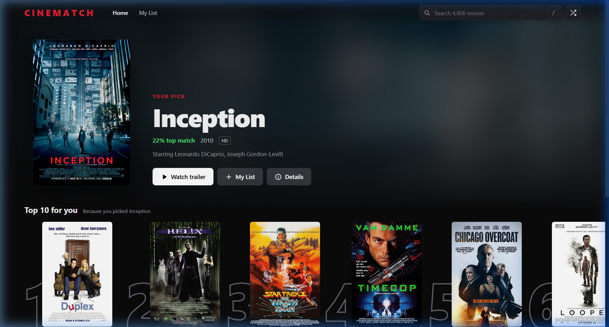

# Cinematch: Content-Based Movie Recommendation System

Cinematch is an end-to-end movie recommendation engine that computes content similarities across movie plots, genres, cast members, directors, and thematic keywords. The system utilizes natural language processing and vector space modeling on the TMDB 5000 dataset, backed by a high-performance Streamlit frontend that renders recommendations through an embedded single-page application.



---

## System Architecture and Workflow

```
+-------------------------------------------------------------------------------+
|                               DATA INGESTION                                  |
|  tmdb_5000_movies.csv (4803 rows)   +   tmdb_5000_credits.csv (4803 rows)     |
+---------------------------------------+---------------------------------------+
                                        |
                                        v  Inner join on 'title' -> 4809 records
+-------------------------------------------------------------------------------+
|                             FEATURE SELECTION                                 |
|  Retained attributes: id, title, overview, genres, keywords, cast, crew       |
+---------------------------------------+---------------------------------------+
                                        |
                                        v
+-------------------------------------------------------------------------------+
|                            DATA PREPROCESSING                                 |
|  - JSON string parsing via ast.literal_eval                                   |
|  - Extract genre names and keyword strings                                    |
|  - Filter top 3 cast members (lead actors)                                    |
|  - Extract crew member where job == 'Director'                                |
|  - Whitespace collapse on entities (e.g. 'Sam Mendes' -> 'SamMendes')         |
|  - Tokenize plot overviews                                                    |
+---------------------------------------+---------------------------------------+
                                        |
                                        v
+-------------------------------------------------------------------------------+
|                              TAG CONSOLIDATION                                |
|  tags = overview + genres + keywords + cast + crew                            |
|  Lowercased text corpus per movie                                             |
+---------------------------------------+---------------------------------------+
                                        |
                                        v
+-------------------------------------------------------------------------------+
|                        STEMMING & VECTORIZATION                               |
|  - Porter Stemmer (NLTK) word root normalization                              |
|  - CountVectorizer (max_features=5000, stop_words='english')                  |
|  - Output: 4806 x 5000 sparse matrix                                          |
+---------------------------------------+---------------------------------------+
                                        |
                                        v
+-------------------------------------------------------------------------------+
|                          SIMILARITY COMPUTATION                               |
|  Cosine similarity across all vector pairs                                    |
|  Output: 4806 x 4806 symmetric distance matrix                                |
+---------------------------------------+---------------------------------------+
                                        |
                                        v  Export artifacts
+-------------------------------------------------------------------------------+
|                             MODEL ARTIFACTS                                   |
|  movie.pkl (DataFrame)                |  similarity.pkl (Cosine matrix)       |
+---------------------------------------+---------------------------------------+
                                        |
                                        v  Loaded once at startup
+-------------------------------------------------------------------------------+
|                             STREAMLIT RUNTIME                                 |
|  - @st.cache_data server-side precomputation of top 20 neighbours per title   |
|  - Serialized JSON payload injected into embedded SPA template                |
|  - Zero-reload client-side interaction (search, modal, watchlist)             |
|  - Asynchronous IMDb poster resolution and browser-side caching               |
+-------------------------------------------------------------------------------+
```

---

## Machine Learning Pipeline

### 1. Data Cleaning and Preprocessing

The raw TMDB dataset contains structured metadata across two tables: movie details and production credits. Both tables are merged on the movie title, followed by schema pruning to isolate descriptive text fields while removing numerical features (budget, popularity, revenue) that do not describe qualitative thematic content.

The selected features require custom parsing because `genres`, `keywords`, `cast`, and `crew` are stored as serialized JSON strings inside CSV fields:

- **JSON Parsing**: The stringified lists are converted into native Python objects using `ast.literal_eval`.
- **Genre and Keyword Extraction**: A parser extracts only the `name` key from each dictionary in the list.
- **Cast Filtering**: Only the top 3 actors are retained per title, focusing similarity on primary leads rather than minor background roles.
- **Director Isolation**: The crew list is iterated to extract the individual whose `job` attribute equals `'Director'`.
- **Whitespace Collapsing**: Multi-word strings are compressed into single uninterrupted tokens. For example, `"Sam Worthington"` becomes `"SamWorthington"` and `"Sam Mendes"` becomes `"SamMendes"`. Similarly, `"Science Fiction"` becomes `"ScienceFiction"`. This prevents the vectorizer from treating common first names as identical tokens, ensuring that directors and actors with identical first names are indexed as distinct categorical entities.
- **Null Value Resolution**: Rows with missing `overview` entries are dropped or populated with empty string values prior to concatenation.

### 2. Tag Synthesis and Stemming

The preprocessed text features are combined into a single unified column named `tags`:

```
tags = overview + genres + keywords + cast + crew
```

The combined string is converted to lowercase to ensure case-insensitive matching.

Before vectorization, the vocabulary is normalized using the **Porter Stemmer** algorithm from NLTK. Stemming reduces inflected or derived words to their base root form (for example, `"activities"`, `"activity"` -> `"activ"`; `"loving"`, `"loved"`, `"lover"` -> `"love"`). This prevents vocabulary fragmentation, compresses the dimensionality of the feature space, and groups related words under the same feature index.

### 3. Feature Extraction and Vectorization

The cleaned text tokens are mapped into a numerical coordinate space using Bag-of-Words via Scikit-Learn's `CountVectorizer`:

- **Vocabulary Cap (`max_features=5000`)**: The vectorizer selects the 5,000 most frequently occurring words across the corpus after stop word removal.
- **Stop Word Elimination (`stop_words='english'`)**: Non-informative grammatical terms (e.g., `"the"`, `"is"`, `"at"`, `"which"`) are stripped from the vocabulary.
- **Matrix Generation**: Each movie $i$ is represented as a 5,000-dimensional vector $\mathbf{v}_i \in \mathbb{R}^{5000}$, where each dimension denotes the term frequency of a specific vocabulary word within that movie's tag profile.

The resulting vector array has shape `(4806, 5000)`.

### 4. Distance Metric: Cosine Similarity

In high-dimensional text spaces (5,000 dimensions), Euclidean distance (L2 norm) performs poorly because it measures absolute coordinate distances rather than angular alignment, making it sensitive to document length. 

To evaluate similarity purely on content direction rather than document size, the cosine similarity metric is employed:

$$
\text{similarity}(\mathbf{A}, \mathbf{B}) = \cos(\theta) = \frac{\mathbf{A} \cdot \mathbf{B}}{\|\mathbf{A}\| \|\mathbf{B}\|} = \frac{\sum_{k=1}^{n} A_k B_k}{\sqrt{\sum_{k=1}^{n} A_k^2} \sqrt{\sum_{k=1}^{n} B_k^2}}
$$

- When two movies share identical vocabulary proportions, $\cos(\theta) = 1.0$.
- When two movies share no overlapping vocabulary, $\cos(\theta) = 0.0$.

The pairwise comparison across all 4,806 movies produces a symmetric $4806 \times 4806$ similarity matrix containing $23,097,636$ float values.

### 5. Recommendation Engine Function

The recommendation logic operates via index-based lookup:

1. Locate the row index of the target movie title:
   ```python
   movie_index = df[df['title'] == movie].index[0]
   ```
2. Retrieve the similarity vector corresponding to that movie index:
   ```python
   distances = similarity[movie_index]
   ```
3. Enumerate the vector to pair each movie's index with its similarity score:
   ```python
   enumerated_scores = list(enumerate(distances))
   ```
4. Sort the pairs in descending order based on the similarity score:
   ```python
   sorted_scores = sorted(enumerated_scores, reverse=True, key=lambda x: x[1])
   ```
5. Extract the top-K entries, slicing from index 1 to K+1 to exclude the query movie itself (which always has an index score of 1.0 against itself):
   ```python
   top_matches = sorted_scores[1:K+1]
   ```
6. Resolve each extracted index back to its corresponding movie title from the DataFrame.

---

## Streamlit Application and Runtime Workflow

Standard Streamlit applications rerun the entire Python script from top to bottom on every user interaction (such as button clicks or dropdown selections). For a recommendation system holding a 184 MB distance matrix in memory, full-script reruns introduce unacceptable latency. Cinematch overcomes this limitation using a hybrid architecture.

### 1. Server-Side Precomputation and Caching

- When Streamlit launches, `build_payload()` executes inside the `@st.cache_data` decorator.
- The server loads `movie.pkl` and `similarity.pkl`.
- Using NumPy's vectorized operations (`np.argpartition` and `np.argsort`), the server pre-indexes the top 20 neighbours and their integer match percentages (0–100%) for all 4,806 movies in memory.
- The precalculated graph is serialized into a compact JSON payload. Subsequent user sessions read this data directly from cache with zero recalculation.

### 2. Zero-Reload Embedded SPA Architecture

- The entire user interface is rendered as a standalone Single-Page Application (HTML5, Vanilla CSS, and modern JavaScript) injected into the Streamlit layout via `streamlit.components.v1.html`.
- All interactive features—instant title searching with prefix ranking, modal details view, horizontal carousel scrolling, and watchlist toggling—execute entirely in the browser's JavaScript runtime.
- Clicking any movie poster, exploring similar titles, or switching tabs updates the DOM instantly without triggering a Python script rerun.

### 3. Asynchronous Metadata and Poster Resolution

- Film posters and release metadata are not stored in local CSV files to keep repository size minimal.
- The client application resolves movie posters dynamically using the IMDb suggestion endpoint (`https://v3.sg.media-imdb.com/suggestion/x/{query}.json`).
- Requests are handled through a prioritized queue with a concurrency throttle (max 6 active requests) to prevent rate limits.
- Fetched metadata is persisted in the browser's `localStorage` (`cm_info_v1`), allowing instant subsequent page paints without duplicate network round trips.
- If network access is restricted or a title lacks an official IMDb entry, a styled CSS fallback card displaying the movie title is rendered automatically.

---

## Repository Structure

```
cinematch/
|-- app.py                  # Streamlit application and embedded SPA
|-- requirements.txt        # Python dependency manifest
|-- Dockerfile              # Container deployment configuration
|-- .dockerignore           # Container build exclusions
|-- .gitignore              # Ignored files, cache directories, and large artifacts
|-- README.md               # Project documentation
|-- .streamlit/
|   |-- config.toml         # Streamlit server and theme configuration
|-- assets/
|   |-- cinematch-preview.png # Application interface preview
|-- data/
|   |-- README.md           # Instructions for downloading raw TMDB datasets
|-- notebooks/
|   |-- analysis.ipynb      # EDA, feature engineering, vectorization, and artifact export
|-- movie.pkl               # Processed movies DataFrame
|-- recs.pkl                # Precomputed top-20 neighbours (~480 KB, tracked for cloud deployment)
|-- similarity.pkl          # Full cosine similarity matrix (184 MB, generated via notebook, gitignored)
```

---

## Setup and Installation

### 1. Clone the Repository

```bash
git clone https://github.com/aditya-forge/cinematch.git
cd cinematch
```

### 2. Configure Environment

Create and activate an isolated Python virtual environment:

```bash
python -m venv .venv

# On Windows:
.venv\Scripts\activate

# On Linux / macOS:
source .venv/bin/activate
```

Install the required dependencies:

```bash
pip install -r requirements.txt
```

### 3. Download the Dataset and Generate Artifacts

1. Download `tmdb_5000_movies.csv` and `tmdb_5000_credits.csv` from [Kaggle TMDB 5000 Movie Dataset](https://www.kaggle.com/datasets/tmdb/tmdb-movie-metadata).
2. Place both CSV files into the `data/` directory.
3. Open `notebooks/analysis.ipynb` and run all cells sequentially. The notebook will:
   - Clean and merge the raw datasets.
   - Run the NLP tag generation, stemming, and vectorization pipeline.
   - Compute the full cosine similarity matrix.
   - Export `movie.pkl` and `similarity.pkl` into the repository root.

### 4. Run the Streamlit Application

```bash
streamlit run app.py
```

The application will be accessible at `http://localhost:8501`.

---

## Deployment

Cinematch is pre-configured for cloud and containerized deployment using the tracked lightweight recommendation model (`recs.pkl`, ~480 KB), allowing deployment without memory exhaustion or external storage requirements.

### Deploy to Streamlit Community Cloud (Recommended)

1. Fork or push this repository to your GitHub account (`aditya-forge/cinematch`).
2. Visit [share.streamlit.io](https://share.streamlit.io/) and authenticate with your GitHub account.
3. Click **New app**.
4. Configure the deployment settings:
   - **Repository**: `aditya-forge/cinematch`
   - **Branch**: `main`
   - **Main file path**: `app.py`
5. Click **Deploy**. The application will initialize and run in dark mode automatically.

### Deploy with Docker

A multi-stage `Dockerfile` is provided in the repository root.

1. Build the Docker image:
   ```bash
   docker build -t cinematch:latest .
   ```

2. Run the container:
   ```bash
   docker run -d -p 8501:8501 --name cinematch cinematch:latest
   ```

3. Open your browser and navigate to `http://localhost:8501`.

---

## Technical Specifications

| Component | Implementation |
|---|---|
| Dataset | TMDB 5000 Movie Dataset (4,806 filtered titles) |
| Natural Language Processing | Porter Stemmer (NLTK) |
| Feature Extraction | CountVectorizer (5,000 features, English stop words) |
| Distance Metric | Pairwise Cosine Similarity |
| Application Framework | Streamlit with embedded JavaScript SPA |
| Asset Delivery | Client-side IMDb Suggestion API with browser localStorage caching |
| Python Compatibility | Python 3.9 through 3.14 |

---

## License

This project is licensed under the MIT License.
